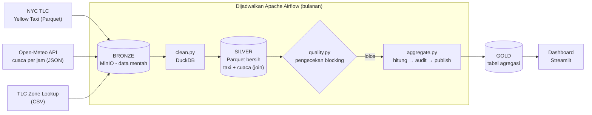
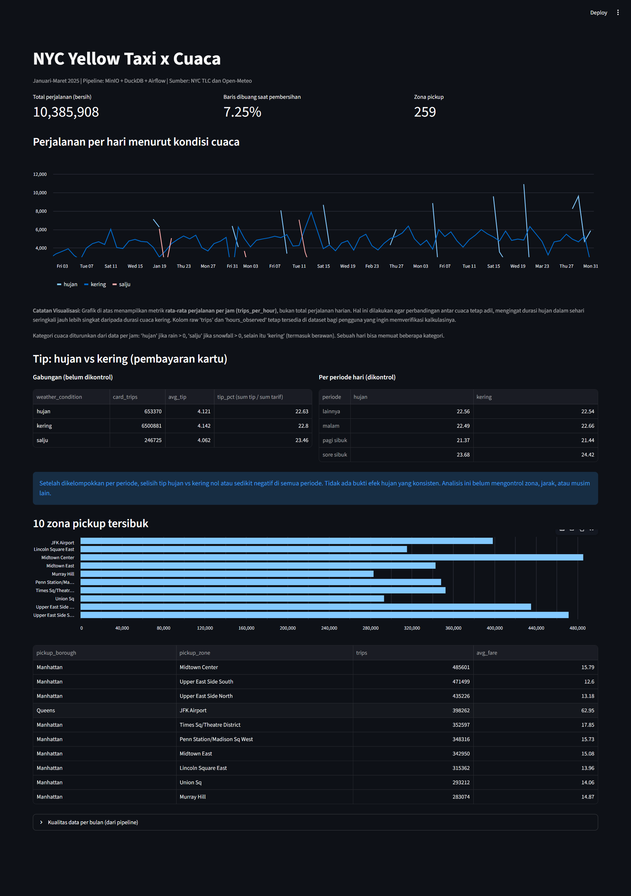
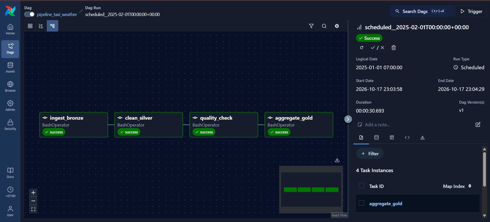

# NYC Taxi x Cuaca: Medallion Lakehouse Lokal

Pipeline data end-to-end yang berjalan sepenuhnya di laptop: data perjalanan **NYC Yellow Taxi** digabung dengan **cuaca per jam** dari Open-Meteo, diproses lewat arsitektur **Bronze → Silver → Gold**, dijadwalkan **Apache Airflow**, divalidasi otomatis, dan ditampilkan di dashboard **Streamlit**.

Project ini meniru pola platform data di cloud (object storage, orkestrasi, query engine) dengan tool lokal yang setara, sehingga arsitekturnya bisa dipindahkan ke cloud tanpa mengubah logika pipeline.

> Cakupan data: Yellow Taxi **Januari-Maret 2025** (± 11,2 juta baris mentah) + cuaca per jam untuk titik koordinat New York.

---

## Daftar Isi

1. [Pertanyaan yang dijawab](#pertanyaan-yang-dijawab)
2. [Arsitektur](#arsitektur)
3. [Tech stack](#tech-stack)
4. [Struktur folder](#struktur-folder)
5. [Cara menjalankan](#cara-menjalankan)
6. [Detail tiap layer](#detail-tiap-layer)
7. [Data quality](#data-quality)
8. [Orkestrasi dengan Airflow](#orkestrasi-dengan-airflow)
9. [Dashboard](#dashboard)
10. [Temuan data](#temuan-data)
11. [Keputusan desain](#keputusan-desain)
12. [Keterbatasan dan pengembangan berikutnya](#keterbatasan-dan-pengembangan-berikutnya)
13. [Sumber data](#sumber-data)

---

## Pertanyaan yang dijawab

1. Berapa rata-rata perjalanan per jam pada kondisi **hujan, salju, dan kering**?
2. Apakah **tip** (pembayaran kartu) berbeda saat hujan dibanding kering, setelah mengontrol periode hari?
3. Zona mana yang paling sibuk sebagai titik penjemputan?

Di balik pertanyaan bisnis itu, tujuan teknis project ini adalah mempraktikkan: ingestion dari file dan API, idempotency, partitioning, schema handling, data modeling, orkestrasi, serta data quality.

---

## Arsitektur



Urutan task di Airflow: `ingest_bronze → clean_silver → quality_check → aggregate_gold`.

<!-- Opsional: tambahkan diagram buatan sendiri di docs/architecture.png -->
<!--  -->

---

## Tech stack

| Komponen | Tool | Peran | Padanan di cloud |
|---|---|---|---|
| Object storage | MinIO (S3-compatible) | Menyimpan bucket `bronze`, `silver`, `gold` | Amazon S3 / GCS |
| Format file | Parquet (ZSTD) | Kolumnar, terkompresi | Sama |
| Transformasi | DuckDB | SQL langsung di atas Parquet/JSON/CSV di S3 | BigQuery / Athena |
| Orkestrasi | Apache Airflow 3.3.2 | DAG, dependency, retry, backfill | MWAA / Cloud Composer |
| Dashboard | Streamlit | Visualisasi dari layer Gold | Looker / Tableau |
| Infrastruktur | Docker Compose | Seluruh service dalam satu perintah | Kubernetes / IaC |
| Bahasa | Python 3.12+ | Script ingest, clean, quality, aggregate | - |

---

## Struktur folder

```
medallion-project/
├── docker-compose.yml        # MinIO, Airflow (+ Postgres, Redis), dashboard
├── Dockerfile                # image Airflow + duckdb, boto3, requests
├── .env.example              # template konfigurasi (salin ke .env)
├── dags/
│   └── pipeline_taxi_weather.py   # DAG bulanan
├── src/
│   ├── ingest.py             # sumber  -> Bronze
│   ├── clean.py              # Bronze  -> Silver (bersih + join cuaca)
│   ├── quality.py            # ukur & validasi Silver, simpan ke silver/_quality
│   ├── aggregate.py          # Silver  -> Gold (hitung -> audit -> publish)
│   └── gold_checks.py        # aturan audit untuk tabel Gold
├── dashboard/
│   ├── app.py                # Streamlit, hanya membaca Gold
│   ├── Dockerfile
│   └── requirements.txt
├── docs/                     # diagram dan screenshot
└── README.md
```

---

## Cara menjalankan

**Prasyarat:** Docker + Docker Compose, RAM minimal 4 GB untuk Docker (Airflow cukup berat), dan koneksi internet (unduh data, ekstensi DuckDB `httpfs`).

```bash
# 1. Siapkan konfigurasi
cp .env.example .env
echo "AIRFLOW_UID=$(id -u)" >> .env
python -c "from cryptography.fernet import Fernet; print('FERNET_KEY=' + Fernet.generate_key().decode())" >> .env
# Edit .env: ganti MINIO_ROOT_PASSWORD

# 2. Build dan inisialisasi
mkdir -p dags logs config plugins src
docker compose build
docker compose up airflow-init        # tunggu sampai selesai (exit 0)

# 3. Jalankan semua service
docker compose up -d
docker compose ps
```

| Service | URL | Login |
|---|---|---|
| Airflow | http://localhost:8080 | `airflow` / `airflow` (kecuali diubah di `.env`) |
| MinIO Console | http://localhost:9001 | sesuai `.env` |
| Dashboard | http://localhost:8501 | - |

**4. Jalankan pipeline:** di UI Airflow, aktifkan (unpause) DAG `pipeline_taxi_weather`. Karena `catchup=True`, tiga run (Jan, Feb, Mar 2025) berjalan berurutan. Setelah selesai, buka dashboard.

**Menjalankan script secara manual (tanpa Airflow)**, dengan MinIO aktif di `localhost:9000`:

```bash
pip install boto3 requests duckdb pandas pyarrow
python src/ingest.py    --months 2025-01 2025-02 2025-03
python src/clean.py     --months 2025-01 2025-02 2025-03
python src/quality.py   --months 2025-01 2025-02 2025-03
python src/aggregate.py
```

**Menguji bahwa pengecekan benar-benar bekerja (sengaja gagal):**

```bash
MAX_DROPPED_PCT=1 python src/quality.py --months 2025-01 2025-02 2025-03   # exit code 1
MAX_TIP_PCT=5     python src/aggregate.py                                    # exit code 1, Gold tidak berubah
```

---

## Detail tiap layer

### Bronze: data apa adanya

Tidak ada transformasi. Tujuannya menyimpan salinan sumber yang bisa dipakai untuk memproses ulang kapan pun.

```
bronze/
├── taxi/year=2025/month=01/yellow_tripdata_2025-01.parquet
├── weather/year=2025/month=01/weather_2025-01.json
└── reference/taxi_zone_lookup.csv
```

- **Idempotent:** path ditentukan oleh **bulan data**, bukan waktu eksekusi. Jika objek sudah ada, script melewatinya (`[skip]`). Flag `--force` menimpa ulang (misalnya sumber direvisi).
- Hanya error 404 yang dianggap "belum ada"; error lain (auth, jaringan) tidak disembunyikan.
- File taxi di-*stream* ke file sementara agar tidak memenuhi RAM. JSON cuaca disimpan sebagai byte mentah.
- Cuaca diambil dengan `timezone=America/New_York` agar jamnya sama dengan waktu lokal data taxi.

### Silver: bersih dan digabung

`clean.py` memakai DuckDB untuk membaca Bronze langsung dari MinIO, lalu menulis `silver/trips_weather/year=YYYY/month=MM/data.parquet`.

**Aturan pembersihan taxi** (baris yang melanggar dibuang):

| Aturan | Alasan |
|---|---|
| `tpep_pickup_datetime` harus di bulan file | Ada data dengan tanggal di luar periode (tahun yang jauh berbeda) |
| `tpep_dropoff_datetime > tpep_pickup_datetime` | Durasi tidak boleh nol atau negatif |
| `trip_distance > 0` | Jarak nol bukan perjalanan valid |
| `fare_amount > 0` | Tarif nol atau negatif tidak valid |
| `tip_amount >= 0` | Tip negatif tidak valid |
| `passenger_count` tidak negatif (`NULL` boleh) | Lihat [temuan](#temuan-data) tentang `NULL` |
| Duplikat persis dibuang | `SELECT DISTINCT` |

**Transformasi lain:**

- **JSON cuaca diratakan.** Respons Open-Meteo berbentuk kolom paralel (`hourly.time`, `hourly.temperature_2m`, ...); `unnest` mengubahnya menjadi satu baris per jam.
- **Join per jam:** `date_trunc('hour', tpep_pickup_datetime)` dengan jam cuaca. Memakai **LEFT JOIN** dari taxi, sehingga kegagalan join muncul sebagai kolom cuaca `NULL` (terdeteksi) dan bukan baris yang hilang diam-diam.
- **Zona:** `PULocationID` diterjemahkan ke nama borough dan zona lewat tabel referensi TLC.

**Hasil pembersihan per bulan:**

| Bulan | Baris Bronze | Baris Silver | Dibuang | Pelanggaran terbanyak |
|---|---:|---:|---:|---|
| 2025-01 | 3.475.226 | 3.252.492 | 6,41% | tarif nol/negatif (145.516) |
| 2025-02 | 3.577.543 | 3.306.288 | 7,58% | tarif nol/negatif (184.096) |
| 2025-03 | 4.145.257 | 3.827.128 | 7,67% | tarif nol/negatif (210.378) |
| **Total** | | **10.385.908** | | |

Satu baris bisa melanggar beberapa aturan sekaligus, sehingga jumlah pelanggaran per aturan bisa melebihi jumlah baris yang dibuang.

### Gold: agregasi untuk dashboard

| Tabel | Grain | Isi |
|---|---|---|
| `daily_trips_by_weather` | tanggal × kondisi cuaca | perjalanan, jam teramati, **perjalanan per jam**, rata-rata tarif |
| `tip_by_weather` | kondisi cuaca | perjalanan kartu, rata-rata tip, persentase tip |
| `tip_by_period_weather` | periode hari × hujan/kering | persentase tip yang **dikontrol periode** |
| `busiest_zones` | borough × zona | jumlah penjemputan, rata-rata tarif |

**Definisi yang dipakai:**

- **Kondisi cuaca:** `hujan` jika `rain > 0`; `salju` jika `snowfall > 0`; selain itu `kering`. Dipakai kata *kering*, bukan *cerah*, karena hari berawan tanpa hujan ikut masuk kategori ini.
- **Tip hanya untuk pembayaran kartu** (`payment_type = 1`), karena tip tunai tidak tercatat di data.
- **Persentase tip = `sum(tip) / sum(fare)`**, bukan rata-rata persentase per baris, yang terlalu dipengaruhi tarif kecil.

---

## Data quality

Pengecekan berlapis, dengan prinsip **fail fast**: lebih baik dashboard menampilkan angka valid terakhir daripada angka baru yang salah.

### 1. Silver: `quality.py`

Mengukur Silver vs Bronze per bulan dan menyimpan hasilnya sebagai **data** di `silver/_quality/` (dibaca dashboard, bukan sekadar dicetak ke log).

| Jenis | Pengecekan | Perilaku |
|---|---|---|
| **Blocking** | Silver tidak kosong | Pipeline gagal |
| **Blocking** | Baris dibuang ≤ `MAX_DROPPED_PCT` (default 15%) | Pipeline gagal |
| **Blocking** | Tidak ada baris tanpa cuaca (join sehat) | Pipeline gagal |
| **Blocking** | Tidak ada tip negatif lolos ke Silver | Pipeline gagal |
| **Blocking** | Jumlah jam cuaca = hari × 24 | Pipeline gagal |
| **Informational** | Jumlah `passenger_count` `NULL` | Dicatat saja |

Pemisahan *blocking* vs *informational* disengaja: temuan yang sudah dipahami penyebabnya tidak boleh menggagalkan pipeline.

### 2. Gold: `gold_checks.py` (pola write-audit-publish)

`aggregate.py` menghitung semua tabel sebagai tabel sementara, mengauditnya, dan **baru menulis ke `gold/` jika semua lolos**. Jika audit gagal, tidak ada satu pun tabel Gold yang disentuh.

| Kategori | Pengecekan |
|---|---|
| **Completeness** | Total `daily_trips_by_weather` = total baris Silver; `busiest_zones` 99-100% dari Silver; total perjalanan kartu di kedua tabel tip konsisten |
| **Primary key (grain)** | Kombinasi kolom grain unik dan tidak `NULL` di setiap tabel |
| **Anomaly** | Persentase tip 0-`MAX_TIP_PCT`% (default 50); jam teramati 1-24; laju per jam > 0; tarif rata-rata zona > 0 |

Seluruh pengecekan sudah diuji dengan sengaja memaksa gagal (lihat [Cara menjalankan](#cara-menjalankan)).

---

## Orkestrasi dengan Airflow

DAG `pipeline_taxi_weather`: empat task berurutan, satu run = satu bulan data.

```
ingest_bronze → clean_silver → quality_check → aggregate_gold
```

- **Bulan diturunkan dari *data interval*** (`{{ data_interval_start.strftime('%Y-%m') }}`), bukan di-hardcode, sehingga backfill tidak mengubah kode.
- **`CronDataIntervalTimetable("@monthly")`:** run memproses bulan yang sudah lewat. Timetable default Airflow 3 untuk cron tidak punya data interval, sehingga bisa memproses bulan yang belum selesai.
- **`retries=2` pada ingest** (kegagalan jaringan bersifat sementara), **`retries=0` pada quality** (pelanggaran kualitas deterministik, retry tidak membantu).
- **`max_active_runs=1`:** bulan diproses satu per satu agar `aggregate_gold` tidak berjalan bersamaan.
- **`end_date`** membatasi jadwal ke 3 bulan sesuai cakupan data.
- Jika `quality_check` gagal, `aggregate_gold` berstatus **`upstream_failed`** dan Gold tidak diperbarui.

**Memproses ulang:** *clear* run bulan tertentu di UI (run lain tidak ikut berjalan), atau gunakan fitur Backfill untuk rentang bulan. Hasilnya idempotent: total Gold (10.385.908 perjalanan) sama dengan total Silver sebelum dan sesudah run ulang.

---

## Dashboard

Streamlit membaca **hanya layer Gold** (plus `silver/_quality` untuk metrik kualitas) lewat DuckDB, dengan cache 5 menit.

Isi dashboard:

1. KPI: total perjalanan bersih, persentase baris dibuang, jumlah zona.
2. Tren **perjalanan per jam** menurut kondisi cuaca.
3. Tip hujan vs kering: tabel gabungan dan tabel per periode hari.
4. 10 zona tersibuk.
5. Tabel kualitas data per bulan.

<!-- Tambahkan screenshot:


-->

---

## Temuan data

Bagian ini mencatat hal-hal yang ditemukan selama analisis, termasuk dua kesalahan interpretasi yang dikoreksi.

**1. `passenger_count` kosong terpusat, bukan acak.** Pada Januari, seluruh 413.268 baris `NULL` di Silver punya `payment_type = 0` (VendorID 2, 1, dan 6). Di data dictionary TLC, kode ini adalah *flex fare* <!-- TODO: konfirmasi ulang dengan data dictionary TLC sebelum publish -->. Kolom ini tidak dipakai metrik Gold, sehingga `NULL` dipertahankan; membuangnya akan menghilangkan sekitar 12% perjalanan yang sah. Metrik penumpang di masa depan harus mengecualikan baris ini secara eksplisit.

**2. Total per kategori cuaca menyesatkan (masalah eksposur).** Garis "hujan" tampak jauh di bawah "kering" pada grafik total perjalanan, tetapi itu karena jumlah jam hujan jauh lebih sedikit. Setelah dinormalisasi menjadi **perjalanan per jam**, kedua garis berdekatan. Kategori cuaca yang jarang terjadi tampil terputus karena tidak ada observasi pada hari itu; nilainya sengaja tidak diisi 0.

**3. Efek hujan pada tip hilang setelah dikontrol (Simpson's paradox).** Metrik awal (rata-rata persentase per baris) menunjukkan tip saat hujan sekitar 0,75 poin persentase lebih tinggi. Setelah memakai `sum(tip)/sum(fare)` dan membandingkan di dalam periode yang sama:

| Periode | Hujan | Kering | Selisih (poin) |
|---|---:|---:|---:|
| lainnya | 22,56% | 22,54% | +0,02 |
| malam | 22,49% | 22,66% | -0,17 |
| pagi sibuk | 21,37% | 21,44% | -0,07 |
| sore sibuk | 23,68% | 24,42% | -0,74 |

Kesimpulan yang aman: **tidak ada bukti efek hujan yang konsisten** pada persentase tip. Analisis ini belum mengontrol zona, jarak perjalanan, atau musim lain.

---

## Keputusan desain

| # | Keputusan | Alasan | Trade-off |
|---|---|---|---|
| 1 | **Arsitektur medallion (3 layer)**, Bronze tidak pernah diubah | Bisa diulang dari data mentah; tanggung jawab tiap tahap terpisah | Butuh penyimpanan lebih banyak |
| 2 | **Path berbasis bulan data, bukan waktu eksekusi**, dan menimpa file yang sama | Idempotent dan mendukung backfill tanpa salinan ganda | Revisi sumber butuh `--force` |
| 3 | **MinIO + `boto3`** (protokol S3) | Kode hampir tidak berubah saat pindah ke S3 sungguhan | Image yang dipakai adalah fork komunitas (`pgsty/minio`) karena image resmi tidak lagi tersedia di Docker Hub; kode hanya bergantung pada protokol S3, jadi storage bisa diganti |
| 4 | **DuckDB** sebagai engine | Ringan, SQL langsung di atas Parquet/JSON/CSV di S3, tanpa cluster | Tidak terdistribusi (cukup untuk ± 11 juta baris) |
| 5 | **Parquet + ZSTD**, partisi `year=/month=` | Kolumnar, terkompresi, query efisien | Kolom bernama sama dengan kunci partisi (mis. `month`) ditimpa oleh DuckDB; kolom kualitas dinamai `year_month` |
| 6 | **LEFT JOIN** taxi ke cuaca | Kegagalan join terlihat sebagai `NULL`, tidak menghilangkan baris diam-diam | Perlu pengecekan `no_weather` |
| 7 | **Fail fast** untuk pelanggaran kualitas | Dashboard lebih baik menampilkan angka valid terakhir daripada angka baru yang salah | Pipeline bisa berhenti karena ambang yang terlalu ketat |
| 8 | **Pengecekan dipisah: blocking vs informational** | Temuan yang sudah dipahami tidak perlu menggagalkan pipeline | Perlu disiplin menentukan kategori |
| 9 | **Write-audit-publish untuk Gold** | Gold tidak pernah tertulis dengan data yang gagal audit | Satu tahap tambahan |
| 10 | **Gold dihitung ulang penuh dari seluruh Silver** | Sederhana dan konsisten, urutan run tidak memengaruhi hasil | Tidak efisien untuk data sangat besar |
| 11 | **Metrik hati-hati**: "kering" bukan "cerah", `sum/sum` bukan rata-rata persentase, tip hanya kartu, perjalanan per jam | Menghindari kesimpulan menyesatkan | Penjelasan metrik lebih panjang |
| 12 | **`retries=0` untuk quality, `retries=2` untuk ingest** | Kegagalan jaringan sementara; pelanggaran kualitas deterministik | - |
| 13 | **Streamlit** (bukan Metabase) | Konfigurasi dashboard berupa kode yang bisa direview di Git | Perlu menulis kode |
| 14 | **Secret di `.env`**, hanya `.env.example` di-commit | Tidak ada kredensial di repository | Perlu langkah setup manual |

---

## Keterbatasan dan pengembangan berikutnya

**Keterbatasan yang diketahui:**

- **Silver ditimpa sebelum divalidasi.** Hanya Gold yang terlindungi write-audit-publish; jika `quality_check` gagal, Silver bulan itu sudah berisi data hasil run tersebut. Perbaikan: tulis ke path *staging*, validasi, lalu promosikan ke path final.
- **`quality_check` hanya memeriksa bulan run itu**, sedangkan `aggregate_gold` membaca semua bulan. Silver bulan lain yang rusak tidak akan terdeteksi saat bulan lain dijalankan ulang. Perbaikan: `aggregate.py` memverifikasi bahwa semua bulan di `_quality` lolos.
- **Satu titik koordinat cuaca** untuk seluruh New York, dan cuaca hanya dipetakan ke jam penjemputan.
- **Analisis cuaca terbatas:** tiga bulan musim dingin hingga awal semi, dan belum ada uji signifikansi atau kontrol zona dan jarak.
- **Belum ada tes otomatis (unit/integration) atau CI.** Validasi saat ini berupa pengecekan data dalam pipeline.
- **`CeleryExecutor` cukup berat** untuk laptop; `LocalExecutor` lebih ringan untuk skala project ini.
- Membutuhkan internet saat pertama kali jalan (ekstensi DuckDB `httpfs`, unduh data).

**Pengembangan berikutnya:**

- Path staging untuk Silver (write-audit-publish di semua layer).
- Tes dengan `pytest` dan GitHub Actions.
- Transformasi Silver → Gold dengan **dbt-duckdb** (tes dan dokumentasi otomatis).
- Memperluas ke lebih banyak bulan, dan versi **PySpark** untuk perbandingan.
- Sumber data kedua dari Indonesia (misalnya harga pangan atau cuaca BMKG).

---

## Sumber data

- **NYC TLC Trip Record Data** (Yellow Taxi dan Taxi Zone Lookup): NYC Taxi & Limousine Commission.
- **Cuaca:** [Open-Meteo](https://open-meteo.com/) (Historical Weather API). Data cuaca oleh Open-Meteo.com, lisensi CC BY 4.0.

Project ini dibuat untuk pembelajaran dan portfolio data engineering.
